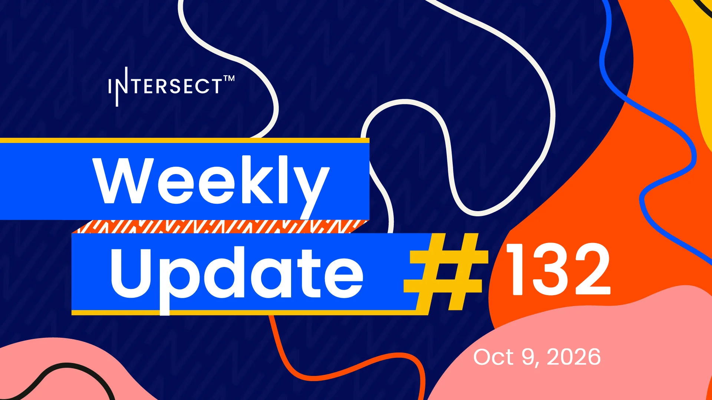

The revised amendment defines the minimum pool margin and moves to deprecate the old minimum pool cost guardrail, which would otherwise have blocked that change. Node 11.2 is due to carry the full Dijkstra feature set without Leios and launch the public DijkstraNet, while 11.3 will seek to merge them with linear Leios into a hard fork release candidate. 30% of mainnet block production runs on versions older than 11.1.2.

[**Read more**](https://www.intersectmbo.org/news/intersect-weekly-update-132-oct-9-2026)

