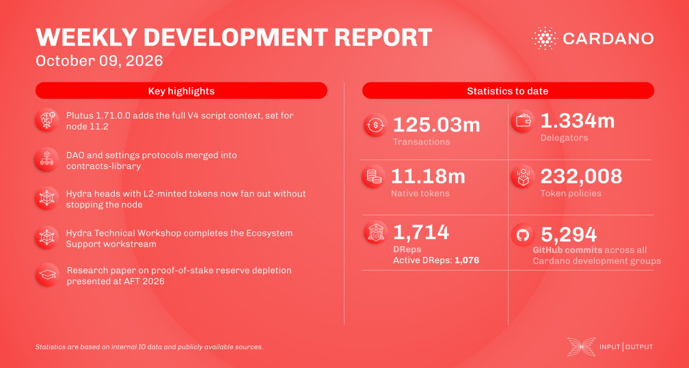

Consensus moved the Leios database to main and released ouroboros-consensus 5.0 and 5.1.0.0, while the mempool reserves capacity for an Endorser Block that comes from Dijkstra-era protocol parameters and is zero in every earlier era. Hydra fixed a fanout step that crashed nodes holding tokens minted on layer 2, and research presented a paper on reserve depletion in proof-of-stake systems at AFT 2026.

[**Read more**](https://www.essentialcardano.io/development-update/weekly-development-report-2026-10-09)

