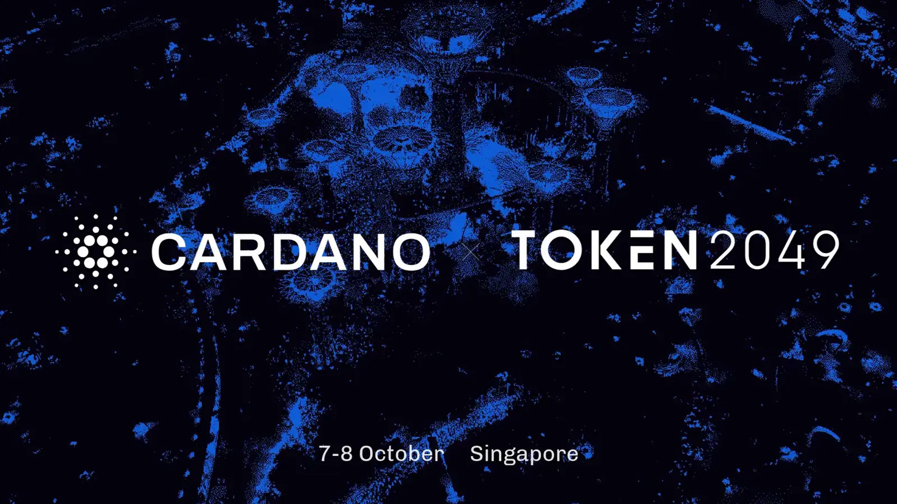

Frederik Gregaard, the Foundation's chief executive, used a fireside chat called Beyond the Token to argue that tokenized assets should start from full transparency on a public chain and add privacy layers on top. More than 30 projects presented at the booth, and over 700 people registered for Node Diversity Day.

[**Read more**](https://cardanofoundation.org/blog/cardano-token2049)

