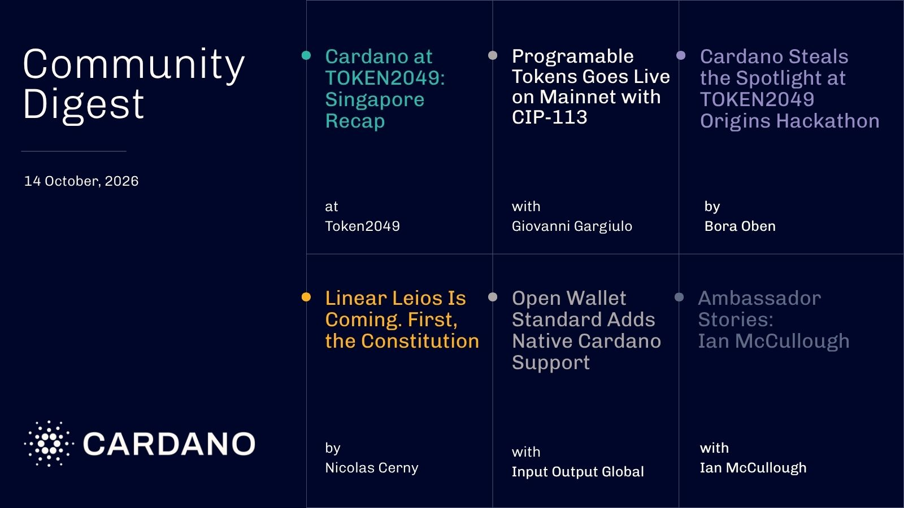

Cardano's booth co-hosted a Rooftop UTXO Pitch Night with Draper Dragon, putting up to $500,000 in front of 90+ investors and nine teams. On mainnet, CIP-0113 lets issuers embed identity, sanctions, and freeze rules inside the asset itself, enforced by the ledger on every transfer. A constitutional draft also opens Dijkstra-era Leios parameters for review ahead of the hard fork vote.

[**Read more**](https://forum.cardano.org/t/digest-october-14-token2049-singapore-recap-programmable-tokens-live-on-mainnet-cardano-steals-the-spotlight-at-token2049-origins-hackathon-ambassador-stories-with-ian-mccullough-and-more/157370)

