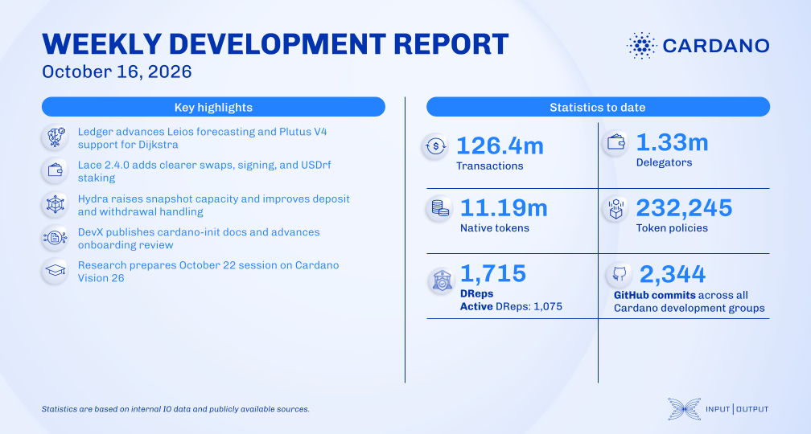

Hydra's snapshot transaction cap went from 1,000 to 4,000, and a local three-node test processed a burst of 24,000 minimal self-transfers in 13.50 seconds, down from 37.04 seconds, a result the team limits to that test setup. Dijkstra forecasting gained Peras protocol parameters, Plutus V4 became the maximum script language for Dijkstra, and Lace 2.4.0 adds USDrf staking.

[**Read more**](https://www.essentialcardano.io/development-update/weekly-development-report-2026-10-16)

