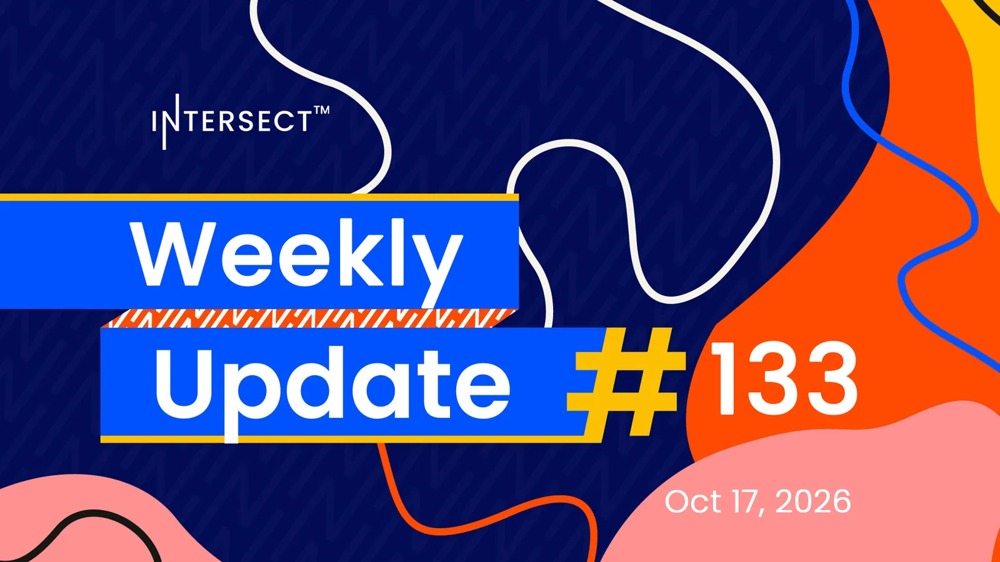

Musashi Dojo, the linear Leios testnet, entered its Fire phase: load and stress testing at global scale on a network larger than Preview or Preprod, to work out initial mainnet parameters. The Intersect Parameter Committee opened a public research RFP asking how low the minimum UTxO cost can safely go, and every project funded through the 2026 budget now has an on-chain contract. Node 11.1.3 stays the recommended release.

[**Read more**](https://www.intersectmbo.org/news/intersect-weekly-update-133-oct-17-2026)

