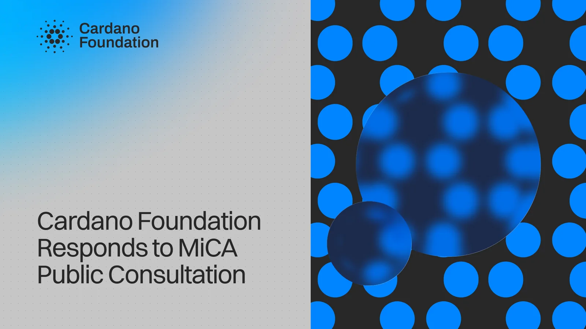

The Cardano Foundation submitted its response on 30 September, arguing that regulation should follow the activity rather than the technology. It wants the MiCA and MiFID II boundary kept, no standalone regime for DeFi or staking, and a clear line between protocol-level participation and custodial or managed services. It opposes a dedicated regime for NFT services and asks for harmonized conflict-of-laws rules for tokenized assets.

[**Read more**](https://cardanofoundation.org/blog/mica-review-consultation-response)

