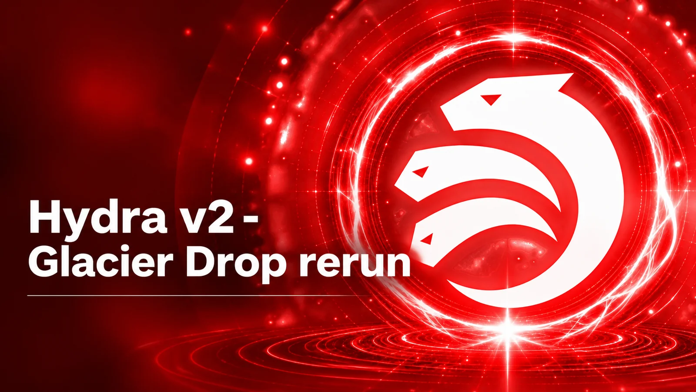

A single head carried 3.5 billion NIGHT of Midnight's Glacier Drop claims over nine days on 10 nodes in October 2025, exposing two bugs that are now fixed. Replaying 24,576 claims gave 79 per second against 42, 4.4 seconds per claim against 9.9, and 339.1 seconds end to end against 590.4. A v2 head opens without a commit phase and takes deposits while running.

[**Read more**](https://www.iog.io/news/hydra-v2-glacier-drop-rerun)

