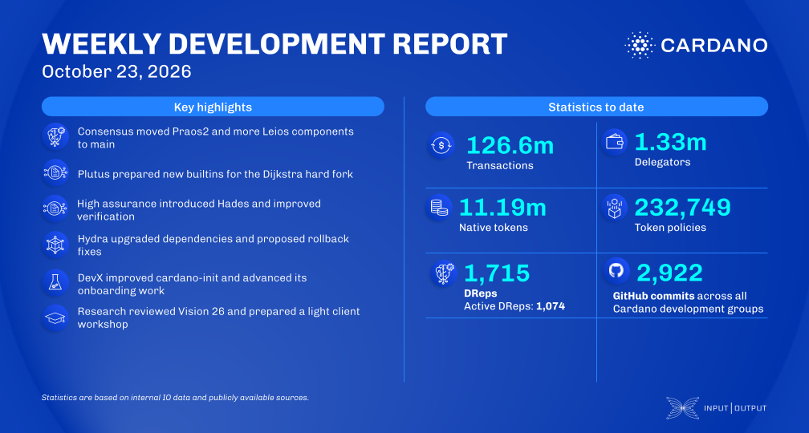

Praos2, which combines Praos with the Leios overlay, merged into main alongside the LeiosNotify clients and fetch servers; Endorser Block selection and fetching come next. The prototype testnet has to restart from genesis for the Leios header format, and mainnet needs no restart. Plutus enabled multiIndexArray and four Value builtins that need Dijkstra, and the High Assurance team shared a first version of Hades.

[**Read more**](https://www.essentialcardano.io/development-update/weekly-development-report-2026-10-23)

