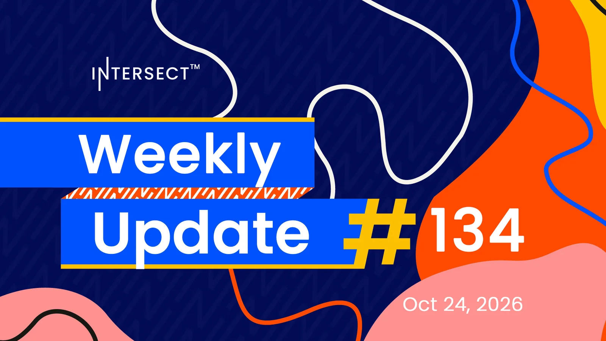

Unspent budget of 115,172 ada went back to the treasury, the first such return of Intersect-administered funds on mainnet. The public Dijkstra testnet opened for SPOs on node 11.1.3, with one-day epochs and a Kleioscan explorer. A new portal tracks how decentralized the network is and shows the method behind each figure. CAP-12 and CAP-3 reached a fourth draft.

[**Read more**](https://www.intersectmbo.org/news/intersect-weekly-update-134-oct-24-2026)

