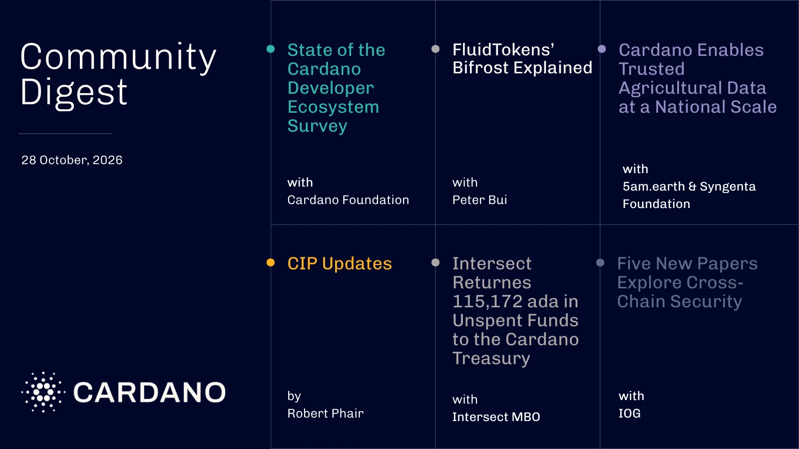

Input Output published five papers on cross-chain security, consensus, post-quantum cryptography, privacy-preserving governance, and the long-term economics of proof-of-stake. 5am.earth has registered 100,000 farms in India on Cardano, Midnight expanded its privacy ambitions across other networks, and the Foundation announced a Cardano Academy collaboration with the University of Nicosia and a case study on blockchain-backed police evidence management.

[**Read more**](https://forum.cardano.org/t/digest-october-28-cardano-developer-survey-leios-and-dijkstra-testnet-five-new-iog-research-papers-cip-updates-100-000-farms-registered-on-cardano-intersect-returns-unspent-treasury-funds-and-more/157612)

