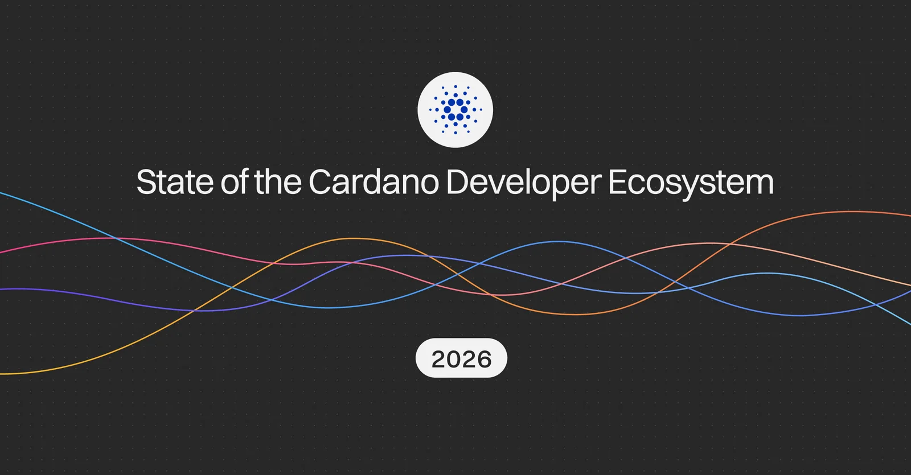

The survey has run since 2022 and asks what developers build, what they build with, and what gets in their way; the answers feed decisions on tools, documentation, and funding. Most questions are optional and adapt to the role, from smart contracts to stake pool operation. Builders can take part until 30 November, in nine languages, and answers are recorded on-chain through CIP-179.

[**Read more**](https://cardanofoundation.org/blog/developer-survey-2026)

