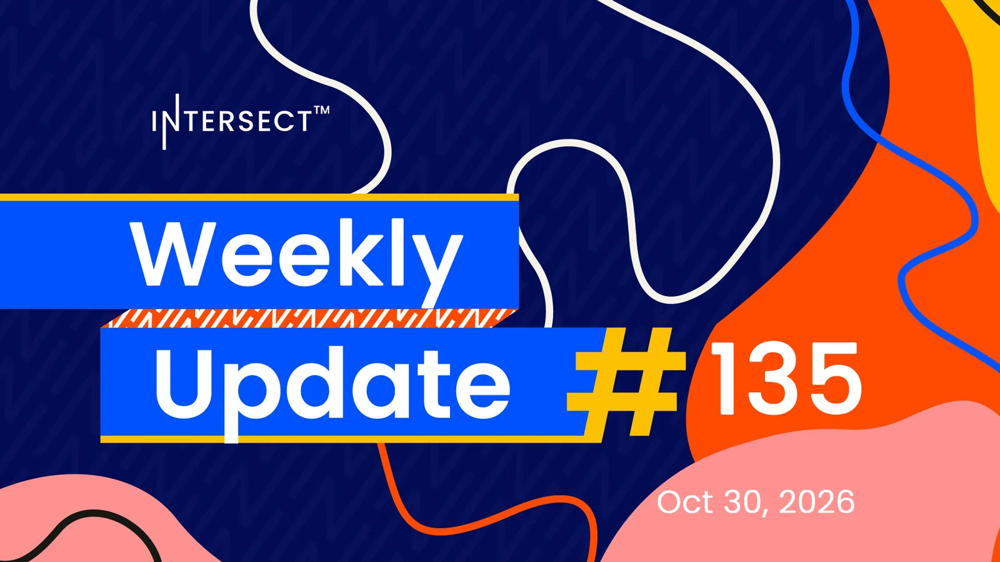

Intersect and partners put forward the Cardano Ecosystem Budget Process (CEBP) for 2027, with feedback open on DRepTalk. A Linux kernel flaw, CVE-2026-98432 at CVSS 9.8, affects many distributions including Ubuntu, so pool operators should reboot once their distribution ships a fix. Node 11.2 carries the full Dijkstra feature set apart from Leios; a tagged pre-release of 11.3 with Leios is realistically three to four weeks away.

[**Read more**](https://www.intersectmbo.org/news/intersect-weekly-update-135-oct-30-2026)

