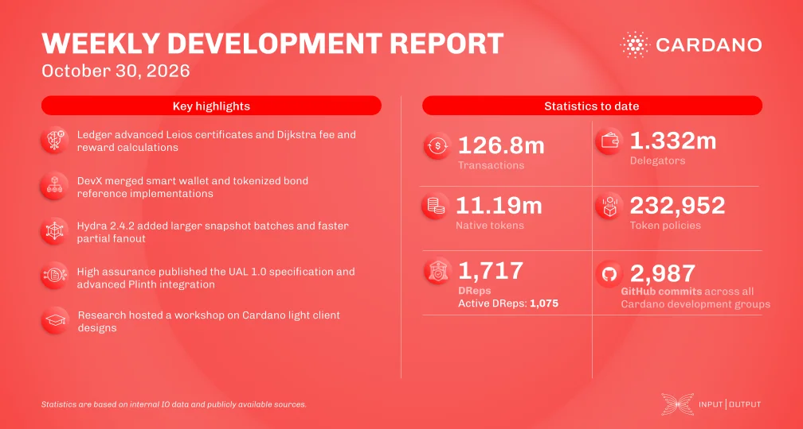

The ledger team added the LEIOSCERT validation rule and block-body certificate checks, implemented Dijkstra minimum-fee calculations, and updated reward calculations to use CIP-23 effective cost and margin. Hydra 2.4.2 shipped on October 22 with larger snapshot batches, faster partial fanout, and cardano-node 11.1.3 compatibility. High Assurance published the Universal Annotation Language (UAL) 1.0 specification, while developer experience merged smart wallet and tokenized bond examples into contracts-library.

[**Read more**](https://www.essentialcardano.io/development-update/weekly-development-report-2026-10-30)

