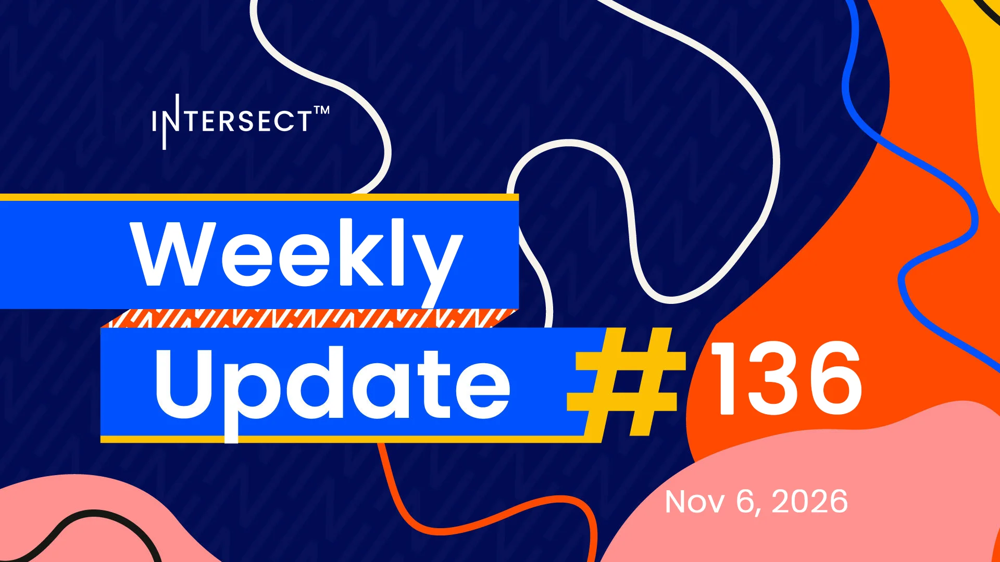

DijkstraNet hard-forked to protocol version 12 on November 2 using the node 11.2 pre-release, allowing integration testing of Dijkstra features without full Linear Leios. DB-Sync 13.8.0.0 released across all networks, while node 11.2.1 is due soon with mainnet clearance and a memory fix. CAP-12 reached version 5 with about 30 values pending, and Intersect's Civics Committee is launching a campaign ahead of EMURGO's planned November 30 DRep deregistration.

[**Read more**](https://www.intersectmbo.org/news/intersect-weekly-update-136-nov-6-2026)

