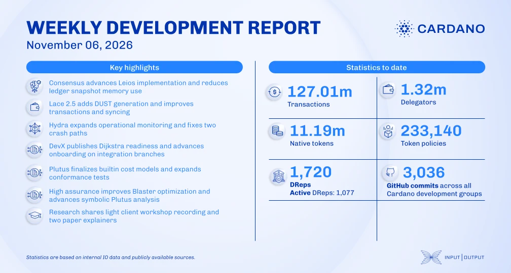

Consensus added endorser block production, chain-selection certificate checks, and vote relaying for Leios on the main development branch, though these changes are not yet a mainnet release. The team also released Leios prototype rc-2026w44 with adaptive endorsements. Plutus finalized cost models for the keepPolicies and dropPolicies builtins and added 65 conformance cases for Value builtins, while Lace 2.5 lets users designate cNIGHT to Midnight addresses to generate DUST.

[**Read more**](https://www.essentialcardano.io/development-update/weekly-development-report-2026-11-06)

