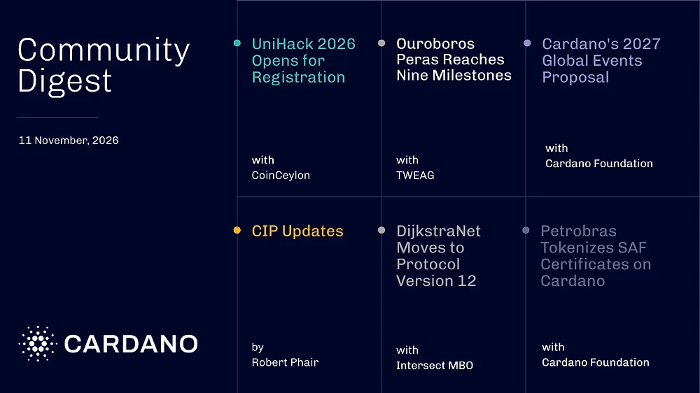

TWEAG's Ouroboros Peras work has completed nine of 12 mainnet roadmap milestones with 76 pull requests merged, while the Cardano Foundation submitted a treasury proposal requesting USD 4,999,155 for 12 global events in 2027. Petrobras is tokenizing sustainable aviation fuel certificates on Cardano, the Cardano Foundation joined CMTA on October 29, and three candidate proposals, CIP-0207, CIP-0208, and CIP-0209, entered the CIP pipeline.

[**Read more**](https://forum.cardano.org/t/digest-november-11-unihack-2026-linear-leios-and-ouroboros-peras-cardanos-2027-events-proposal-new-cip-updates-petrobras-on-cardano-dijkstranet-upgrade-and-more/158024)

