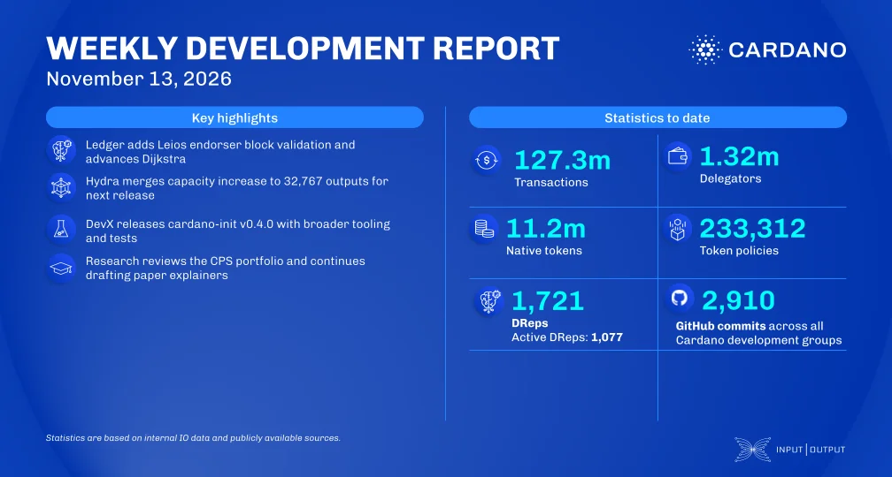

The ledger team implemented validation and application of Leios endorser blocks, exposed a certificate-validation interface, and removed owner-signature requirements for pool updates that only change BLS keys. For Dijkstra, the team changed multi-asset reference-input pricing from per policy to per byte. Hydra merged an output capacity increase from 4,095 to 32,767 for its next release, and developer experience released cardano-init v0.4.0.

[**Read more**](https://www.essentialcardano.io/development-update/weekly-development-report-2026-11-13)

