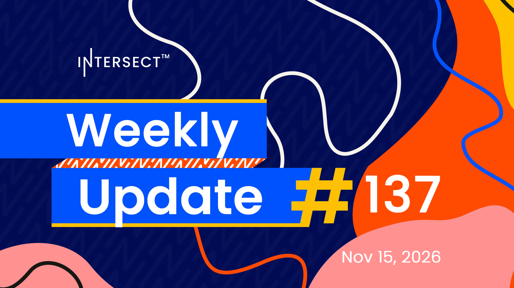

Intersect facilitated the return of 23,063,600 ada from unused Project Catalyst allocations to the Cardano treasury on November 6 and 10, bringing its total returned funds to 23,178,772 ada. Node 11.2.1 reached pre-release on November 9 with memory fixes and LSM approval for block producers, while Input Output delivered initial Babel fees and CIP-159 testnet milestones alongside London's Node Diversity Workshop.

[**Read more**](https://www.intersectmbo.org/news/intersect-weekly-update-137-nov-15-2026)

