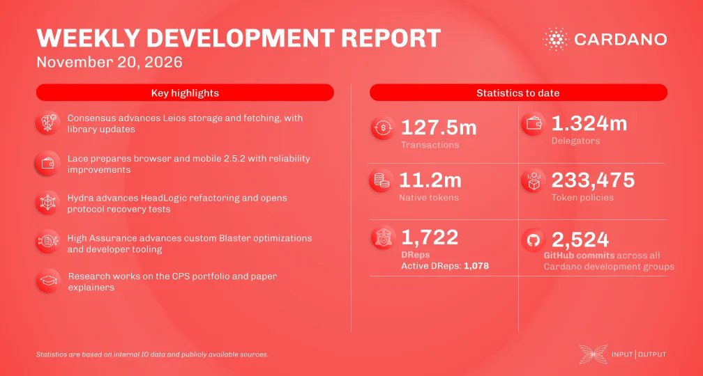

The consensus team simplified Leios endorser-block storage, enabled the fetch server to send stored bytes without decoding, and released ouroboros-consensus 5.4.0.0 and 5.4.0.1 to fix LSM disk-wait accounting. The Lace team prepared Browser Extension 2.5.2 with Midnight Wallet SDK 2.0.0 and Mobile 2.5.2 ahead of planned public releases, while the High Assurance team integrated the native Z3 backend into the Cardano CLI and Hydra split its HeadLogic refactor for review.

[**Read more**](https://www.essentialcardano.io/development-update/weekly-development-report-2026-11-20)

